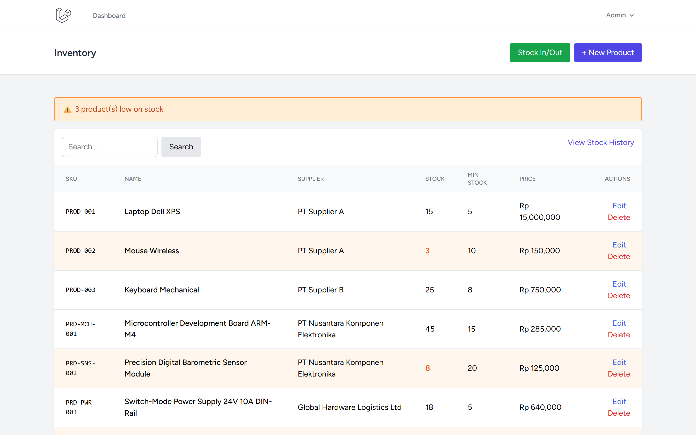
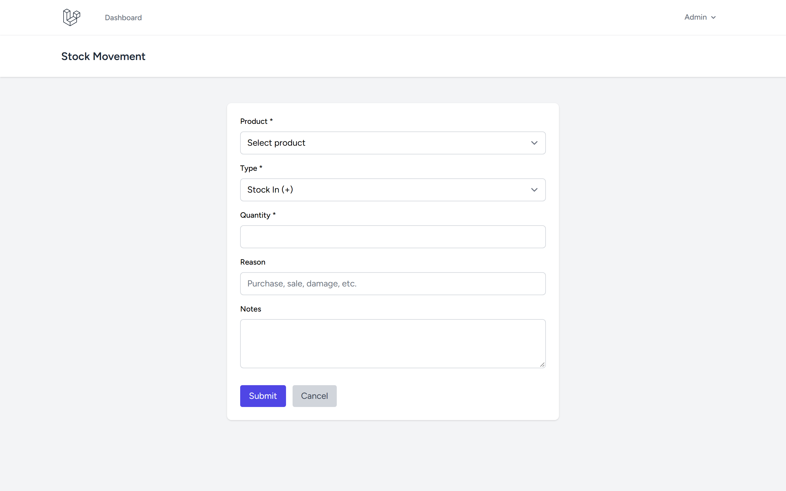
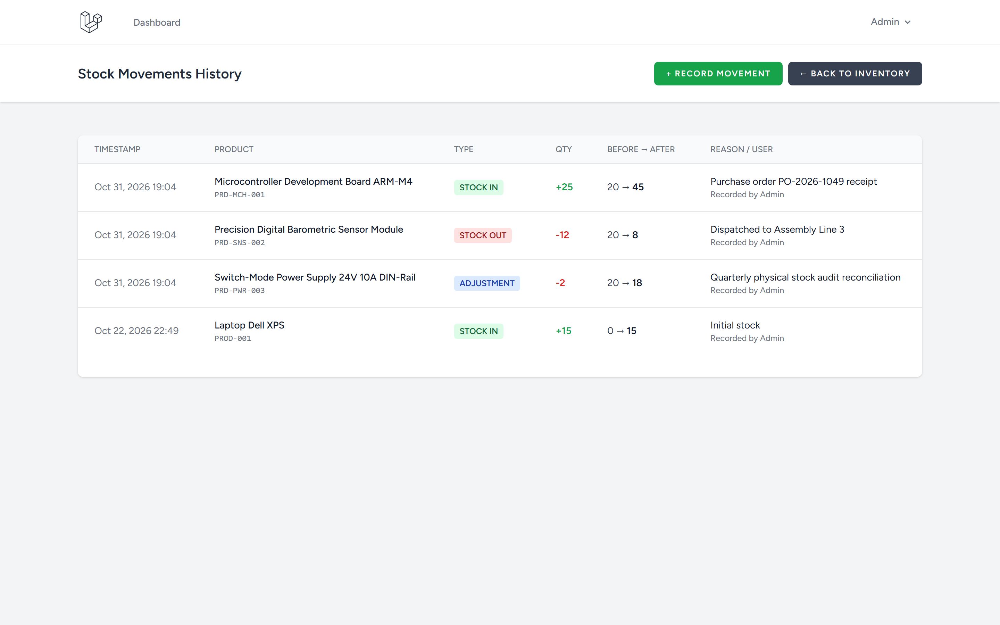
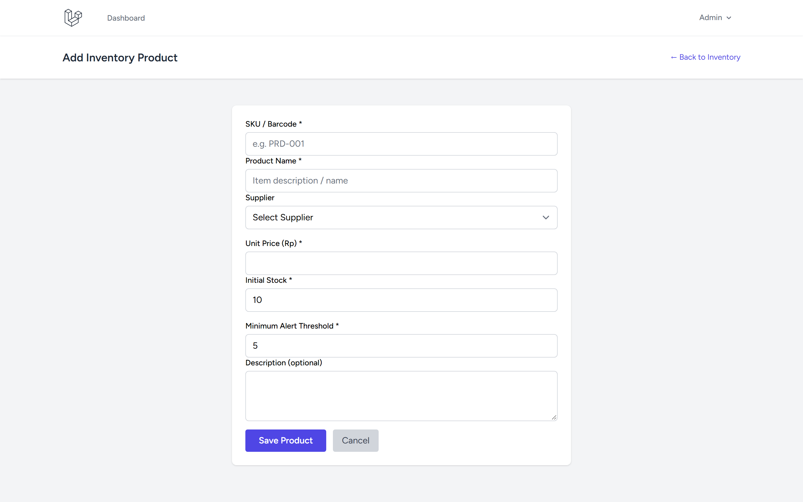

# Inventory Management - Laravel

Complete inventory system with products, suppliers, stock tracking, and low-stock alerts.

Repository: https://github.com/0xyz-exe/inventory-management-laravel

## Screenshots

| Tampilan | Preview |
|---|---|
| **Katalog Inventaris & Peringatan Stok Menipis**<br>Panel katalog produk inventaris dengan banner peringatan stok minimum, kode SKU unik, nama supplier, stok terkini, dan harga unit |  |
| **Formulir Transaksi Mutasi Stok Barang**<br>Formulir pencatatan pergerakan stok (Stock In, Stock Out, Adjustment) dengan validasi kuantitas, alasan mutasi, dan catatan logistik |  |
| **Buku Riwayat Mutasi Stok (Audit Trail)**<br>Tabel riwayat pergerakan stok lengkap dengan badge status tipe pergerakan, kuantitas mutasi (+/-), perubahan stok sebelum/sesudah, dan pencatat |  |
| **Registrasi Produk Baru ke Inventaris**<br>Formulir penambahan barang baru dengan penetapan kode SKU/barcode, pemilihan supplier resmi, harga satuan, dan batas ambang minimum stok |  |

## Features

- ✅ Product catalog with SKU
- ✅ Supplier management
- ✅ Stock-in and stock-out transactions
- ✅ Automatic stock updates
- ✅ Low-stock alerts
- ✅ Stock movement history
- ✅ Database transactions (concurrency-safe)
- ✅ Stock adjustments with reasons
- ✅ Prevent negative stock
- ✅ Audit trail for all movements
- ✅ Search and filtering
- ✅ Authentication (Breeze)

## Tech Stack

- Laravel 13.38.0
- Laravel Breeze 2.4
- PHP 8.5.0
- SQLite
- Tailwind CSS

## Installation

```bash
git clone https://github.com/0xyz-exe/inventory-management-laravel.git
cd inventory-management-laravel
composer install
npm install
cp .env.example .env
php artisan key:generate
touch database/database.sqlite
php artisan migrate --seed
npm run build
php artisan serve
```

## Demo Account

- Email: admin@example.com
- Password: password

## Database Schema

**suppliers:** id, name, contact_person, email, phone, address

**products:** id, supplier_id, sku (unique), name, description, stock, min_stock, unit_price

**stock_movements:** id, product_id, user_id, type (in/out/adjustment), quantity, stock_before, stock_after, reason, notes

## Features Detail

### Product Management
- CRUD operations
- SKU generation
- Supplier assignment
- Minimum stock thresholds
- Unit pricing
- Low-stock detection

### Stock Movements
- Stock-in (purchases, returns)
- Stock-out (sales, damages)
- Adjustments (corrections)
- Automatic stock calculation
- Audit trail with user tracking
- Transaction safety (DB locks)

### Reports
- Current stock levels
- Movement history
- Low-stock alerts
- Supplier-wise inventory

## Security

- Database transactions for stock updates
- Row-level locking prevents race conditions
- Negative stock validation
- User audit trail
- CSRF protection
- Input validation

## Routes

- `/` - Product list with low-stock alerts
- `/products` - CRUD operations
- `/suppliers` - Supplier management
- `/stock` - Stock movement history
- `/stock/create` - Record stock in/out

## Repository

https://github.com/0xyz-exe/inventory-management-laravel
